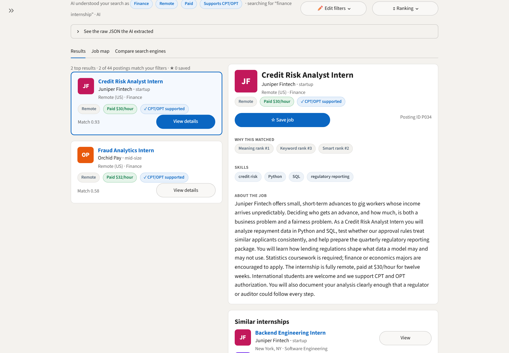
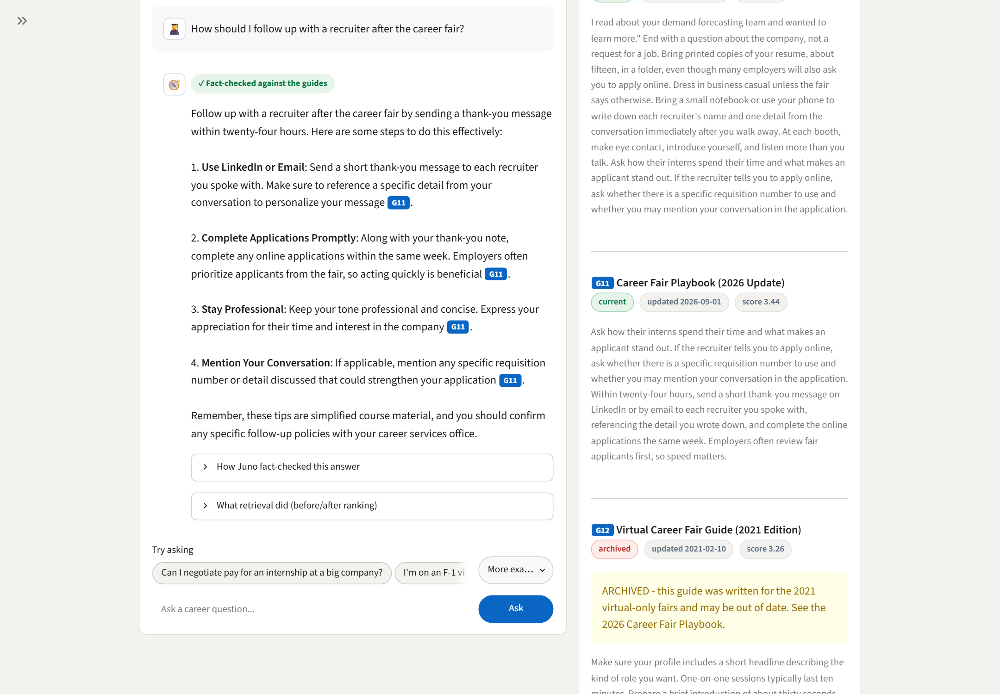
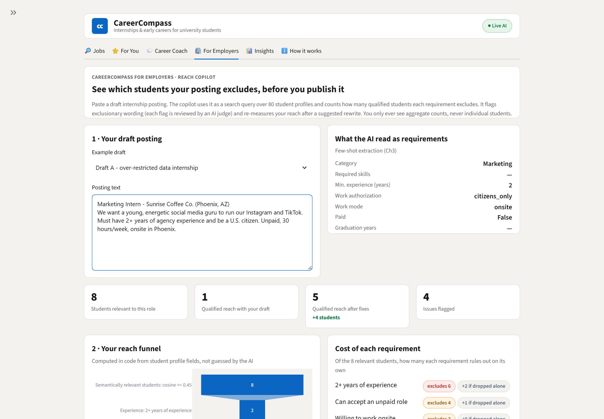
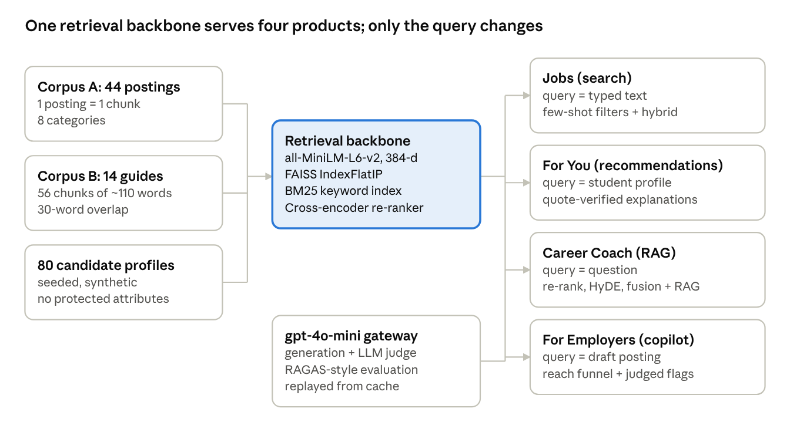

# 🧭 CareerCompass

**An AI-powered internship marketplace: one retrieval backbone, four products.**

CareerCompass helps university students find internships by *meaning* rather than keywords, explains honestly why a
job fits them, answers career questions with cited sources, and shows employers which qualified students their job
posting accidentally excludes. It is built in Python with Streamlit, sentence-transformers, FAISS, BM25 and
OpenAI `gpt-4o-mini`. It runs on a laptop CPU and runs without an API key in demo mode.

> Built for **MIS 552 · AI for Digital Platforms · Homework 2** (Chapter 3: Prompt Engineering, Chapter 4:
> Embeddings & RAG). All data is synthetic.



---

## Contents

1. [The problem it solves](#1-the-problem-it-solves)
2. [Feature tour](#2-feature-tour)
3. [How it works](#3-how-it-works)
4. [Tech stack](#4-tech-stack)
5. [AI techniques used](#5-ai-techniques-used-and-where-they-come-from)
6. [The data](#6-the-data)
7. [Results](#7-results)
8. [Run it](#8-run-it)
9. [Where each homework requirement lives](#9-where-each-homework-requirement-lives)
10. [Project structure](#10-project-structure)
11. [Code walkthrough](#11-code-walkthrough)
12. [Key design decisions](#12-key-design-decisions)
13. [Responsible AI and safety](#13-responsible-ai-and-safety)
14. [Limitations and next steps](#14-limitations-and-next-steps)
15. [Troubleshooting](#15-troubleshooting)
16. [AI-use disclosure](#16-ai-use-disclosure)

---

## 1. The problem it solves

An internship marketplace has three groups of users, and each one has a problem that keyword search can't fix:

| Who | Pain point today | What CareerCompass does |
|---|---|---|
| **Students** | A search like *"remote data analytics internship at a startup that sponsors international students"* returns noise, because no posting uses those exact words. Postings that describe the same job in different words are missed entirely. | Searches by **meaning**, pulls structured filters (remote, paid, visa support) out of plain English, and ranks results with a hybrid of keyword and semantic search. |
| **Students** | Recommendation engines oversell weak matches with generic praise ("great fit!"). | Treats the student's **profile as the search query**, then explains each match by quoting both the profile and the posting, and **checks those quotes in code**. Weak matches are called weak. |
| **Career center** | Advisors answer the same resume, interview and visa questions all day. | **Juno**, an AI career coach that answers *only* from the center's career guides, cites every source, and hands anything it can't answer to a human advisor. |
| **Employers** | Internship postings copy full-time requirements ("3+ years", "U.S. citizens only", "recent grads only") and silently exclude most qualified students. | The **Employer Reach Copilot** counts, before publishing, how many qualified students each requirement excludes, flags exclusionary wording, and measures the reach of a suggested rewrite. |

The core idea, from Chapter 4: **search, recommendation and a RAG assistant are the same retrieval backbone with a
different query.** CareerCompass builds that backbone once and uses it four times.

---

## 2. Feature tour

The app has six tabs, styled like a job portal. A collapsible **Settings** sidebar switches between demo mode and
live mode, and shows how many recorded AI outputs are available.

### 🔎 Jobs: semantic job search
- **Search box in plain English**, with one-click example searches.
- **"AI understood your search as…"**: an LLM converts the query into filter chips (category, work mode, paid,
  visa/CPT-OPT support) and a cleaned search phrase. **Edit filters** lets you correct anything the AI got wrong, and
  **See the raw JSON** shows exactly what was extracted.
- **Ranking** menu: *Smart* (hybrid keyword + meaning), *Meaning* (embeddings only) or *Keywords* (BM25), a keyword
  weight slider, and an optional **AI re-rank** with a cross-encoder.
- **Results list and job detail panel**: company-logo cards, pay and visa badges, **Save job**, *Why this matched*
  (the posting's rank under each engine), skills, the full description, and **Similar internships**.
- **Job map** sub-tab: every posting plotted in 2-D (a PCA projection of the embeddings), colored by category, with
  your query as a ⭐ and your results circled.
- **Compare search engines** sub-tab: BM25 vs. vector vs. hybrid side by side on 7 benchmark queries, with recall@5
  scores.

### ⭐ For You: recommendations where the profile is the query
- Pick an example student or paste your own resume summary. Set **must-haves** (needs CPT/OPT support, paid only,
  remote only).
- **Top job picks**: the profile is embedded and used as the search query. Each card shows:
  - a **match %** and its label (strong, possible or weak)
  - a **"How you match" skills checklist**
  - an explanation
  - **quotes from your profile and from the job**, each marked ✓ verified or ✕ not found
  - **what's missing**
  - must-have conflicts as red warnings (never silently hidden)
  - the AI's step-by-step scoring reasoning, on demand
- Sub-tabs: *your profile on the job map*, *prompt iteration v1 vs. v2* (the naive prompt next to the improved one)
  and the *honesty test* (a culinary student matched against an all-tech corpus).

### 💬 Career Coach: "Juno", a RAG advisor
- A chat interface with suggested questions (including some deliberately outside the guides).
- Every answer is **grounded in retrieved guide excerpts** and **cites them inline** (blue `G07`-style tags). The
  **Sources** panel shows each excerpt with its status (current or archived), its date and its retrieval score.
- A **fact-check badge** on each answer: ✓ passed, ↻ fixed after one retry, or → routed to a human advisor.
- *How Juno fact-checked this answer* shows each draft and the judge's verdict. *What retrieval did* shows a
  before/after ranking table.
- **Coach settings**: choose the retrieval pipeline (baseline, re-rank, HyDE, RAG fusion, combined), **ignore
  archived guides**, or **stress-test the fact-checker** by injecting a deliberately wrong draft.

### 🏢 For Employers: Reach Copilot (the innovation feature)
1. Paste a draft posting. The AI shows the **requirements it read**: skills, years of experience, work
   authorization, work mode, pay and graduation year.
2. **Reach KPIs**: relevant students, qualified reach of the draft, reach after the fixes, and the number of issues
   flagged.
3. **Reach funnel**, computed in code from student profile fields: the number of students left after each
   requirement. **Cost of each requirement**: how many relevant students it excludes on its own, and how many would
   return if only it were dropped.
4. **Suggested fixes**: exclusionary wording flagged by the AI (plus a code check for work-authorization
   restrictions with no legal basis), each **scored by an AI judge**. The employer toggles which fixes to apply.
5. **Improved posting**: a rewritten draft, with its reach measured against the same pool of students.

Only aggregate counts are shown, never an individual student.

### 📊 Insights: did the AI upgrades actually help?
- KPI tiles, then a chart and a table comparing **5 retrieval pipelines** on **context recall, faithfulness and answer
  relevance** across 15 coach questions, with the change against the baseline.
- A **before/after ranking** for any question and upgrade, an **observed failures** table with the
  pre-retrieval / retrieval / post-retrieval diagnosis framework, refusal results on out-of-scope questions, and
  search recall by engine.
- In live mode, a button re-runs the whole evaluation.

### ℹ️ How it works
The architecture diagram, the course concepts used, and how demo mode works.

| Career Coach (live) | Employer Reach Copilot (live) |
|---|---|
|  |  |

---

## 3. How it works



**One backbone.** Three corpora (44 postings, 14 career guides split into 56 chunks, and 80 candidate profiles) are
embedded with `all-MiniLM-L6-v2` (384 dimensions, normalized) and stored in FAISS indexes. A BM25 keyword index sits
beside them. Each product sends a different *query* through the same backbone:

| Product | Query | Retrieval | What the LLM does | Safety check |
|---|---|---|---|---|
| Jobs | typed text | BM25 / vector / hybrid, with metadata filters; optional cross-encoder re-rank | few-shot extraction of filters into JSON | the user can see and edit the extracted filters |
| For You | the student's profile | vector search over postings | grounded fit explanation and score (JSON) | code verifies every quoted phrase |
| Career Coach | the question | baseline / re-rank / HyDE / RAG fusion / combined, over guide chunks | answer in the Juno persona, with citations | similarity gate, out-of-scope rule, LLM judge, code citation check, one retry, then a human |
| For Employers | the draft posting | cosine over candidate profiles | constraint extraction, flags, judge, rewrite | funnel computed in code; legal restrictions kept; aggregates only |

**Two runtime modes.**
- **Demo mode (no API key):** every retrieval step runs live on your machine: embeddings, FAISS, BM25, the
  cross-encoder, PCA and the reach funnel. Only the `gpt-4o-mini` outputs are **replayed** from
  `cache/llm_cache.json`. Each recorded output is keyed by a hash of the exact prompt, model and settings, so a
  replayed answer can never be shown for a different request. A typed request that was never recorded shows a clear
  "not cached" notice. Search filters and employer constraints fall back to a labeled keyword heuristic instead.
- **Live mode (`OPENAI_API_KEY` set):** new requests call `gpt-4o-mini`, and the answers are added to the cache.

---

## 4. Tech stack

| Layer | Technology | Why |
|---|---|---|
| UI | **Streamlit 1.66**, custom CSS theme (`.streamlit/config.toml`, `careercompass/ui.py`), **Plotly** | Fast interactive web app; job-portal look; interactive charts |
| Embeddings | **sentence-transformers** `all-MiniLM-L6-v2` | Free, local, CPU-friendly; the course lab's model |
| Vector index | **FAISS** `IndexFlatIP` | Exact cosine search; Meta's library from the course |
| Keyword search | **rank-bm25** (`BM25Okapi`) | Catches rare exact terms |
| Re-ranking | **cross-encoder** `ms-marco-MiniLM-L6-v2` | Reads the query and the document together |
| Projection | **scikit-learn PCA** | A fixed linear map, so a new query can be placed on the map |
| LLM | **OpenAI `gpt-4o-mini`** through one cached `chat()` gateway | Cheap and fast; demo mode without a key |
| Deep-learning runtime | **PyTorch 2.6 (CPU)** | Runs the two local models; no GPU needed |
| Data | JSON corpora + a seeded Python generator | Synthetic and reproducible |
| Tooling | Playwright (screenshots), Node `docx` (report) | Optional; only for producing the report |

---

## 5. AI techniques used, and where they come from

| Technique | Where in the app | Course source |
|---|---|---|
| Zero-shot classification with a fixed label set | Employer language flags | Ch3, Step 1 |
| **Few-shot prompting → JSON** (null for absent fields) | Search filter extraction, employer constraint extraction | Ch3, Step 2 (Zillow pattern) |
| Structured summarization and extraction | Fit explanations with quotes, gaps and a score | Ch3, Step 3 |
| **System prompt + persona** (voice + policy) | Juno, the career coach | Ch3, Step 4 |
| Chain-of-thought before deciding | Fit scoring (v2 prompt) | Ch3, Step 5 |
| **LLM-as-judge guardrail** (draft → judge → retry → human) | Coach fact-check; employer flag review | Ch3, Step 6 (DoorDash pattern) |
| One `chat()` gateway with a mock/cached mode | `careercompass/llm.py` | Ch3/Ch4 notebook helper |
| **Text embeddings + vector database** | All four products | Ch4 lab, Parts 2–3 |
| **Keyword vs. vector vs. hybrid search** | Jobs tab and its comparison | Ch4 lab, Part 4 |
| **RAG with grounding and a code-side guardrail** | Coach answers; recommendation quotes | Ch4 lab, Part 5 |
| **Cross-encoder re-ranking** (retrieve 10, keep 3) | Coach and Jobs | Ch4 lab, Part 6 |
| **HyDE** (search with a hypothetical answer) | Coach | Ch4 lab, Part 7 |
| **RAG fusion** (query rewrites + reciprocal rank fusion) | Coach | Ch4 slides, "Advanced RAG" |
| **RAGAS-style evaluation** (context recall, faithfulness, answer relevance) | Insights tab | Ch4 lab, Part 8 |
| Profile as query; new records count with no retraining | For You; Employer Copilot | Ch4 "RAG meets the platform"; credit-scoring lab |
| Chunk size and overlap; outdated-document checks | Guide chunking; "ignore archived guides" | Ch4 "How RAG can go wrong" |

Every prompt is listed in [prompts.md](prompts.md), generated from the code, together with the documented v1 → v2
prompt iteration and its measured results.

---

## 6. The data

All data is synthetic and stored in `data/`.

| Dataset | Size | Contents | Retrieval challenges planted deliberately |
|---|---|---|---|
| **Corpus A: postings** (`postings.json`) | 44 postings, 8 categories | title, fictional company, category, location, remote/hybrid/onsite, paid flag and pay, visa sponsorship flag, skills, and a 120+ word description that agrees with the flags | near-duplicates differing in one detail (P001/P002, P021/P022, P028/P029); rare exact terms (PostgreSQL, SAP Ariba, OR-Tools); paraphrase targets with **zero** keyword overlap with their queries (P007, P027); lawful citizenship restrictions (P018, P039) |
| **Corpus B: career guides** (`guides.json`) | 14 articles (320–349 words) → 56 chunks | resumes, graduate CVs, behavioral and technical interviews, networking, offers, negotiation, etiquette, cover letters, work authorization, career fairs, return offers, portfolios | conflicting advice (G01 vs. G02 on resume length); an **archived** 2021 virtual-fair guide (G12) that contradicts the 2026 playbook (G11); G10 labeled *simplified course material, not legal guidance* |
| **Candidate pool** (`candidates.json`, from `generate_candidates.py`) | 80 student profiles | program, level, graduation year, skills, years of experience, work-mode preference, paid-only, needs CPT/OPT | none: **no name, age, gender, race or address** |
| **Scenarios** (`scenarios.json`) | — | 6 search presets; 7 benchmark queries with gold postings; 4 student profiles (one deliberately mismatched); 15 coach questions with gold guides; 4 out-of-scope questions; 2 employer drafts | the answer keys used by the evaluation |

---

## 7. Results

All numbers come from `cache/eval_results.json` and `prompts.md`, and are shown live in the Insights tab.

**Search: recall@5 on 7 benchmark queries.** BM25 **0.71**, vector **0.79**, hybrid **0.86**.
- Vector search finds the paraphrase targets at rank 1, where BM25 ranks them 43 and 21.
- BM25 finds rare product names at rank 1, where vector search ranks them 5–6.
- The hybrid is the most robust overall.

**Coach: 15 in-scope questions, 5 retrieval pipelines** (lab-style RAGAS metrics):

| Pipeline | Context recall | Faithfulness | Answer relevance | Answered |
|---|---|---|---|---|
| Baseline (vector top-3) | 0.90 | 1.00 | 0.99 | 15 |
| Re-rank (top-10 → cross-encoder top-3) | **0.97** | 1.00 | 0.93 | 14 |
| HyDE | 0.93 | 1.00 | 0.93 | 14 |
| RAG fusion (3 rewrites + RRF) | 0.87 | 1.00 | 0.93 | 14 |
| HyDE + re-rank (combined) | **0.97** | 1.00 | 0.93 | 14 |

- Refusal accuracy on 4 out-of-scope questions: **100%** (3 refused by the coach prompt, 1 by the similarity gate).
- **Negative results, reported honestly.** RAG fusion lowered recall. The upgrades routed one conflicted question to
  a human, which lowered answer relevance. The baseline answered one question from the *archived* guide, and the
  judge passed it, because faithfulness can't detect stale knowledge. The "ignore archived guides" setting fixes that
  case. Every failure is listed in the Insights tab.

**Recommendations.** On partial matches, the naive v1 prompt scored 68–80 on average, against 34–51 for the grounded
v2 prompt. The mismatched culinary profile scored 0–2 under both. v2's quotes were verified word for word: 102 of 104.

**Employer copilot.** On the over-restricted demo draft, qualified reach rose from **0 to 14** of 26 relevant
students after the fixes. On a new live draft (shown in the screenshot above) it rose from 1 to 5 of 8.

---

## 8. Run it

**Requirements:** Python 3.10–3.12 (tested on 3.12, Windows 11), about 2 GB of disk space for libraries and models.
No GPU and no API key needed.

### Demo mode (recommended for grading)

```powershell
cd CareerCompass
py -3.12 -m venv .venv
.venv\Scripts\activate
pip install torch==2.6.0 --index-url https://download.pytorch.org/whl/cpu
pip install -r requirements.txt
streamlit run app.py
```

On macOS/Linux: `python3 -m venv .venv` and then `source .venv/bin/activate`.

The app opens at <http://localhost:8501>. On the **first** launch two models download (~90 MB each) and the first page
load takes 30–60 seconds. After that, the app is fast. Every example in every tab works without a key.

### Live mode

```powershell
$env:OPENAI_API_KEY = "sk-..."        # or once, permanently:  setx OPENAI_API_KEY "sk-..."
streamlit run app.py
```

The top bar shows **● Live AI**. The key is read only from the environment and is never written to any file. The
sidebar's demo-mode toggle switches back to recorded outputs at any time.

### Maintenance commands

| Command | What it does | Needs a key |
|---|---|---|
| `python build_cache.py --index-only` | Re-embeds the corpora and rebuilds the FAISS indexes | No |
| `python build_cache.py` | Records every demo output and re-runs the full evaluation (~300 calls, well under $0.50; recorded calls replay for free) | Yes |
| `python tools/verify_cached.py` | Checks that every preset in every tab replays with no key | No |
| `python tools/export_prompts.py` | Regenerates `prompts.md` from the prompts in the code | No |
| `python tools/take_screenshots.py live http://localhost:8502` | Captures the report's live screenshots (needs `pip install playwright` and `playwright install chromium`) | Yes |

The file watcher is disabled in `.streamlit/config.toml`, so **restart the app after editing code**.

---

## 9. Where each homework requirement lives

| Requirement | Where to see it in the app | Code |
|---|---|---|
| **A** Chunking, embedding, FAISS index | How it works tab; this README §12 | `data.py`, `backbone.py` |
| **A** Semantic-space map with the query marked | Jobs → *Job map* (and For You → *your profile on the job map*) | `app.py: semantic_map`, `backbone.py` (PCA) |
| **B** Natural-language search box with ranked results | Jobs → Results | `search.py` |
| **B** Few-shot filter extraction with nulls, JSON visible | Jobs → filter chips, *Edit filters*, *See the raw JSON* | `search.py` (`FILTER_FEW_SHOT`, shot 3 = all nulls) |
| **B** BM25 vs. vector vs. hybrid on 3+ queries (exact term + paraphrase) | Jobs → *Compare search engines* | `backbone.py`, `evaluation.search_recall_at_k` |
| **C** Profile as query, top 5 | For You | `recommend.recommend` |
| **C** Grounded explanations quoting both texts, fit score with reasoning | For You cards (quotes ✓/✕, *See how the AI scored this*) | `recommend.py` (`EXPLAIN_V2`, `verify_quotes`) |
| **C** Honesty test with a mismatched profile | For You → *Honesty test* and *Prompt iteration* | `scenarios.json` PR4 |
| **D** Named persona in a system prompt | Career Coach (Juno) | `coach.COACH_SYSTEM_PROMPT` |
| **D** Inline citations + evidence panel | Coach answer tags + *Sources* panel | `coach.py`, `app.py` |
| **D** Refusal and routing to a human | Coach → the out-of-scope suggestions | similarity gate + `OUT_OF_SCOPE` rule in `coach.py` |
| **D** LLM-as-judge with badge and fallback | Coach badge; *How Juno fact-checked*; *Stress test* setting | `coach.judge`, `coach.ask` |
| **E** Two or more advanced techniques | Coach settings: re-rank, HyDE, RAG fusion, combined | `advanced.py` |
| **E** Before/after ranking table | Coach → *What retrieval did*; Insights → *Before / after ranking* | `advanced.rank_table` |
| **E** RAGAS (fallback) on 6+ questions, baseline vs. upgraded, as a chart | Insights tab (15 questions, 5 pipelines) | `evaluation.py`, `cache/eval_results.json` |
| **E** Failure diagnosis (pre / retrieval / post) | Insights → *Observed failures* + framework | `cache/eval_results.json` |
| **F** Innovation feature for a second stakeholder | For Employers tab | `employer.py` |
| Demo app with 4+ tabs, runs without a key | All six tabs, demo mode | `app.py`, `llm.py`, `cache/` |
| Prompts, data-generation prompt, prompt iteration | [prompts.md](prompts.md) | `tools/export_prompts.py` |
| Design and evaluation report | `report/CareerCompass_Report.docx` | `report/build_report.js` |

---

## 10. Project structure

```
CareerCompass/
├── app.py                        Streamlit UI: 6 tabs + settings sidebar
├── build_cache.py                Builds indexes, records LLM outputs, runs the evaluation
├── requirements.txt              Pinned dependencies (install torch CPU first; see §8)
├── prompts.md                    Every prompt, the data-generation prompt, the v1→v2 iteration
├── README.md                     This file
├── .streamlit/config.toml        Job-portal theme; file watcher off
├── .gitignore
├── careercompass/                The application package
│   ├── config.py                 Paths, model names, chunk size/overlap, calibrated thresholds
│   ├── llm.py                    The single chat() gateway + response cache (demo/live modes)
│   ├── data.py                   Corpus loading, posting text, sentence-aware chunking
│   ├── backbone.py               Embeddings, FAISS, BM25, hybrid, cross-encoder, PCA map
│   ├── search.py                 Few-shot filter extraction + filtered retrieval      (Part B)
│   ├── recommend.py              Profile-as-query + grounded explanations v1/v2         (Part C)
│   ├── coach.py                  Juno: persona, RAG, citations, refusal, judge          (Part D)
│   ├── advanced.py               Re-rank, HyDE, RAG fusion (RRF), combined pipeline     (Part E)
│   ├── evaluation.py             Context recall, faithfulness, relevance, refusals      (Part E)
│   ├── employer.py               Employer Reach Copilot                                 (Part F)
│   └── ui.py                     Styling, cards, chips, badges, KPI tiles
├── data/
│   ├── postings.json             Corpus A: 44 internship postings
│   ├── guides.json               Corpus B: 14 career-guide articles
│   ├── candidates.json           80 synthetic candidate profiles
│   ├── generate_candidates.py    Seeded generator for candidates.json
│   └── scenarios.json            Presets, benchmarks + gold answers, eval questions, drafts
├── cache/                        Shipped so the app runs with no key
│   ├── index/                    Prebuilt embeddings (.npy) + FAISS indexes (.faiss) + metadata
│   ├── llm_cache.json            300 recorded gpt-4o-mini outputs
│   ├── eval_results.json         Full evaluation results
│   └── eval_results.csv          The same results, per question and pipeline
├── tools/
│   ├── verify_cached.py          Proves every preset works with no API key
│   ├── export_prompts.py         Regenerates prompts.md from the code
│   └── take_screenshots.py       Headless-browser screenshots for the report
└── report/
    ├── CareerCompass_Report.docx Design and evaluation report (Word)
    ├── build_report.js           Generates the report (Node + docx)
    └── figures/                  Pipeline diagram, semantic map, eval chart, live screenshots
```

---

## 11. Code walkthrough

| Module | Responsibility | Key functions |
|---|---|---|
| `llm.py` | All LLM traffic goes through one function. Responses are cached by a SHA-256 hash of (model, messages, temperature, JSON mode). In demo mode a missing entry raises `NotCached` instead of inventing an answer. | `chat`, `chat_json`, `is_live`, `set_force_cached` |
| `data.py` | Loads the corpora. Builds the posting text (structured facts first). Splits guides into sentence-aware ~110-word chunks with ~30 words of overlap and adds the article title to each. | `posting_text`, `chunk_article`, `build_chunks` |
| `backbone.py` | Embeds the three corpora and loads or rebuilds the FAISS indexes (rebuilt when a corpus changes). Runs BM25, the 50/50 min-max hybrid, the cross-encoder re-ranker and the PCA map. | `posting_search`, `posting_hybrid_search`, `rerank_postings`, `chunk_vector_search`, `rerank_chunks`, `project` |
| `search.py` | Few-shot prompt → `{category, remote, paid, visa_sponsorship, semantic_query}`. Applies the filters to posting metadata, plus a labeled keyword fallback. | `extract_filters`, `filtered_search`, `rule_based_filters` |
| `recommend.py` | Profile → top postings. v1/v2 explanation prompts. Code verification of quotes. Must-have conflict badges. | `recommend`, `explain_fit`, `verify_quotes`, `must_have_conflicts` |
| `advanced.py` | Five retrieval pipelines over the guide chunks, and the before/after rank table. | `retrieve`, `hypothetical_answer`, `multi_queries`, `reciprocal_rank_fusion`, `rank_table` |
| `coach.py` | Juno's system prompt. Similarity gate → retrieve → draft → `OUT_OF_SCOPE` check → LLM judge + code citation check → one retry with the judge's feedback → route to a human. | `ask`, `judge`, `citation_check` |
| `evaluation.py` | Context recall against gold guides, an LLM judge for faithfulness and relevance, refusal accuracy, and search recall@5. Saves JSON and CSV. | `run_evaluation`, `search_recall_at_k` |
| `employer.py` | Constraint extraction → reach funnel and cost per requirement over the candidate pool (in code) → LLM flags + code check → judge → rewrite → re-measured reach. | `extract_constraints`, `reach`, `all_flags`, `judge_flags`, `rewrite` |
| `app.py` | The six-tab UI. Retrieval runs on every interaction; LLM calls are cached. | — |

---

## 12. Key design decisions

- **Chunking follows the model's limit.** `all-MiniLM-L6-v2` silently truncates after 256 tokens. Postings stay whole
  (200–254 tokens, measured), because a posting is the unit a student applies to; structured facts come first, so
  only description text could ever be cut. Guides are split into ~110-word chunks with ~30-word overlap (56 chunks,
  max 236 tokens), and each chunk carries its article title.
- **Thresholds were measured, not guessed.**
  - The coach's similarity gate is 0.22, because the lowest-scoring *in-scope* question ("reach out to an alum for a
    coffee chat") scored 0.278 and a stricter gate would refuse it. The prompt rule catches the rest.
  - Employer relevance is cosine ≥ 0.45, which on the demo draft keeps business-analytics, information-systems,
    data-science and supply-chain students.
- **Hybrid search** uses the course lab's min-max-normalized 50/50 blend, with the weight exposed as a slider.
- **PCA, not t-SNE**, for the map, because a fixed linear projection can place a new query into the existing map.
- **Before/after reach uses the same relevant pool.** The rewrite is scored against the students relevant to the
  *original* duties, so the change measures the requirements alone.
- **Code checks back up every prompt rule:** quotes are verified, citations must point to retrieved guides, the reach
  funnel is computed from profile fields, and work-authorization restrictions are always flagged when no legal reason
  is given.
- **Evaluation uses the brief's labeled fallback**: lab-style metrics instead of the `ragas` library. Context recall
  is exact against gold guide IDs, and a `gpt-4o-mini` judge scores faithfulness and relevance.

---

## 13. Responsible AI and safety

- **Privacy and fairness:** candidate profiles contain no name, age, gender, race, photo or address. The employer
  copilot shows aggregate counts only.
- **Visa status:** must-have conflicts (no CPT/OPT support, unpaid, not remote) appear as warnings and never silently
  hide jobs. Work-authorization restrictions with a stated legal basis (export control, security clearance) are kept,
  and the copilot never suggests removing them.
- **Hallucination control:** the coach answers only from retrieved guides, cites every claim, is fact-checked before
  display, and routes to a human advisor when it can't answer reliably.
- **Honest limits:** the work-authorization guide is labeled *simplified course material, not legal guidance*, and
  the coach repeats that caveat. Negative evaluation results are reported, not hidden.
- **Human in the loop:** employers approve every suggested fix, and nothing is published automatically.
- **Synthetic data only:** no real job boards, companies or people.

---

## 14. Limitations and next steps

- **Small corpora** (44 postings, 14 guides), so the metrics are directional. Scaling up would swap `IndexFlatIP`
  for an approximate (ANN) index and push metadata filters into the index.
- **The judge can't detect stale knowledge.** An answer faithful to an outdated guide passes, so document freshness
  must be handled before retrieval (archived flags, dates).
- **Retrieval diversity:** the top 3 chunks sometimes all come from one guide, which misses multi-guide answers.
  Maximal marginal relevance or per-document limits would help.
- **Demo mode replays only recorded requests.** New free-text requests need a key.
- The employer copilot's skill matching is keyword-based. A semantic skill match would be more forgiving.

---

## 15. Troubleshooting

| Symptom | Fix |
|---|---|
| `OSError: [WinError 126] … torch\lib\shm.dll` | Newer torch builds need a newer Visual C++ runtime. Use the pinned CPU build in a fresh venv: `pip install torch==2.6.0 --index-url https://download.pytorch.org/whl/cpu` |
| First load is slow or a model download times out | Normal on the first run (two ~90 MB models). Restart the app if Wi-Fi drops. |
| "No recorded AI output" / "not cached" notice | Expected in demo mode for new typed requests. Use the suggested examples, or set `OPENAI_API_KEY`. |
| `429 insufficient_quota` in live mode | The OpenAI account has no billing credit. |
| `Port 8501 is not available` | Another Streamlit app is running. Close it, or run `streamlit run app.py --server.port 8502`. |
| Code changes don't appear | The file watcher is off by design. Stop and restart `streamlit run app.py`. |

---

## 16. AI-use disclosure

AI coding assistants were used as the course allows (see the report's AI-use section):

- **Claude Code** wrote the application code following the course notebooks' patterns, drafted the synthetic corpora
  from the specification in `prompts.md`, calibrated thresholds by measurement, and drafted the factual parts of the
  report.
- **gpt-4o-mini** performs all in-app generation and judging.

Outputs were verified with headless tests of every tab, `tools/verify_cached.py`, scripted data checks, and manual
review. The analysis and interpretation in the report are the author's own.
